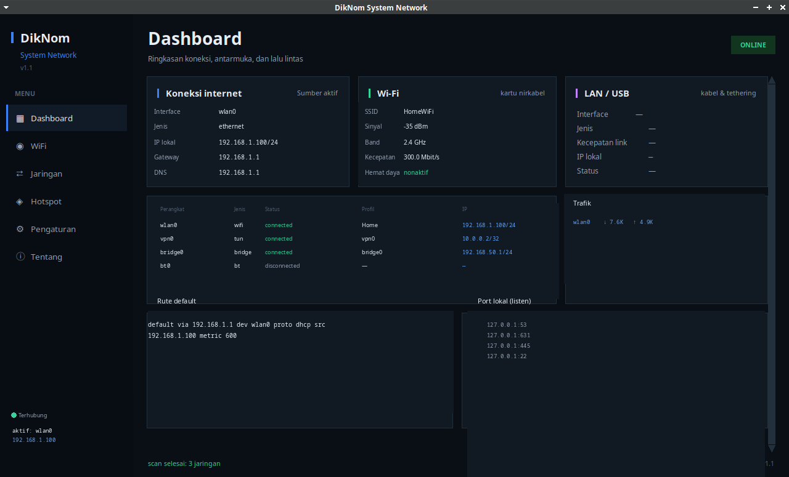
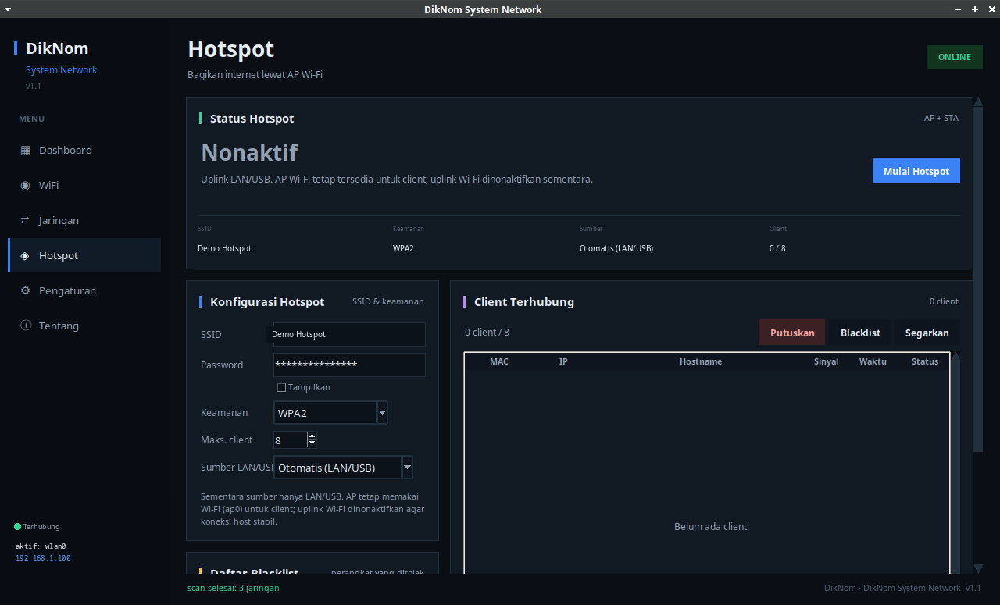
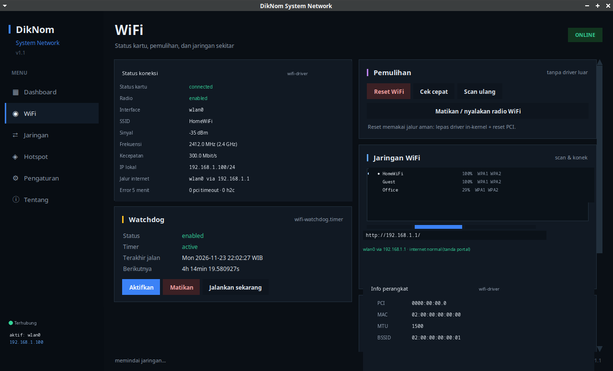
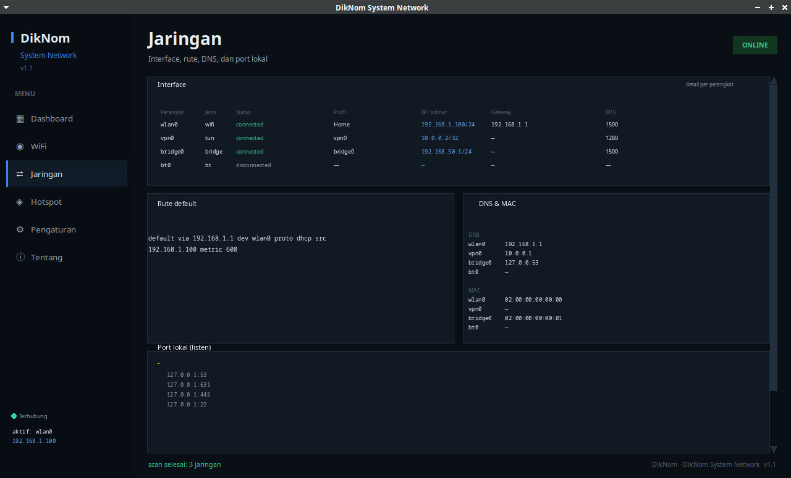
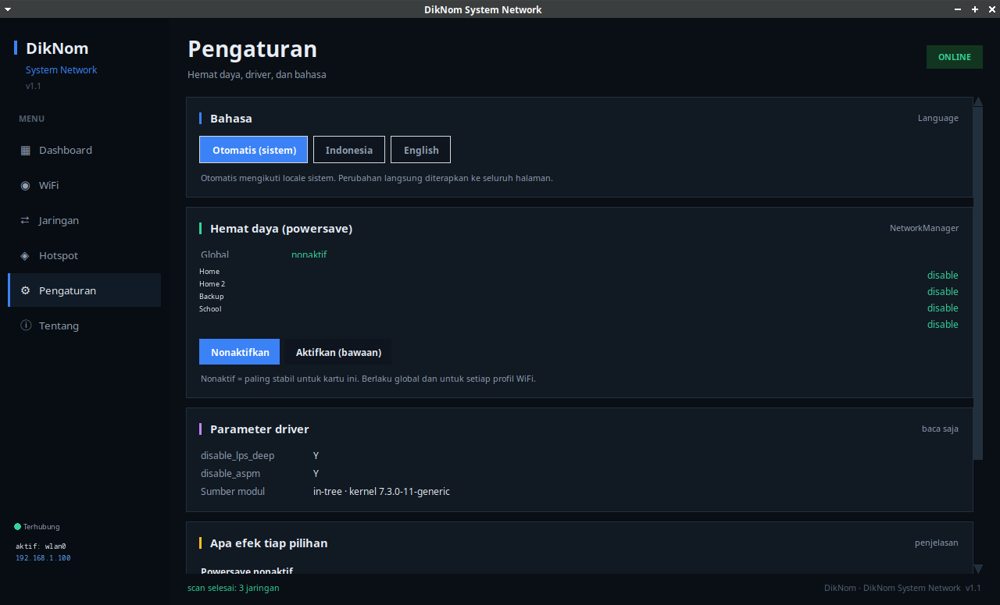
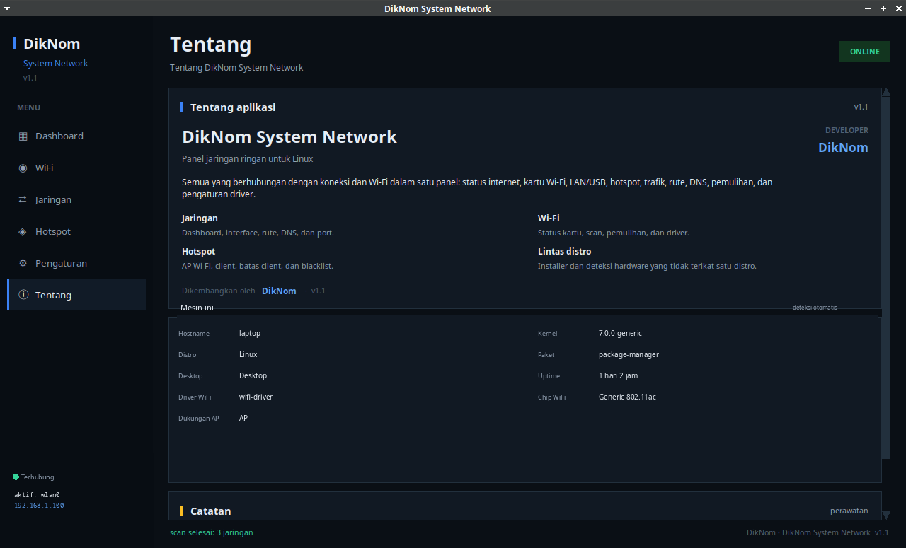

# DikNom System Network

**Panel jaringan ringan untuk Linux** — status internet, Wi-Fi, LAN/USB,
trafik, rute, DNS, pemulihan, dan hotspot Wi-Fi dalam satu aplikasi desktop.

Dibuat oleh **DikNom**. Versi **1.1**.



## Fitur

### Dashboard
Ringkasan koneksi internet, kartu Wi-Fi, LAN/USB, tabel interface, trafik per
interface, rute default, dan port lokal yang sedang listen.

### Wi-Fi
Status kartu dan driver, sinyal, frekuensi, kecepatan link, IP lokal, jalur
internet, penghitung error `pci bus timeout`, watchdog, scan jaringan, koneksi
ke SSID, portal login, info PCI/MAC/MTU/BSSID, dan log kernel.

### Jaringan
Daftar interface beserta status, profil, IP/subnet, gateway, dan MTU; rute
default; DNS dan MAC per interface; serta port lokal.

### Hotspot
AP Wi-Fi virtual (`ap0`) dengan hostapd, dnsmasq, dan iptables:

- SSID, password, keamanan WPA2/WPA3/WPA2-WPA3/Terbuka.
- Batas jumlah client.
- Sumber internet LAN/USB.
- Daftar client, putuskan client, dan blacklist.
- Arsitektur AP Wi-Fi tetap ada; untuk sementara uplink Wi-Fi dinonaktifkan
  pada kartu RTL8822CE/rtw88 agar koneksi host tidak terganggu.



### Pengaturan
Bahasa Indonesia, English, atau otomatis mengikuti locale sistem. Perubahan
langsung diterapkan ke seluruh halaman. Tersedia pengaturan powersave,
parameter driver, dan penjelasan efeknya.

### Deteksi hardware lintas distro
Tidak terikat pada satu nama interface atau satu distro:

- Distro dan package manager dibaca dari `/etc/os-release` dan `PATH`.
- Interface dibaca dari NetworkManager (`nmcli`); jika tidak tersedia,
  fallback ke `/sys/class/net`.
- Driver Wi-Fi dibaca dari `/sys/class/net/<iface>/device/driver` atau
  `ethtool`.
- Chip Wi-Fi dibaca dari `lspci`, dengan fallback ke uevent sysfs.
- Dukungan AP dibaca dari `iw list`.
- Halaman Tentang menampilkan hostname, kernel, distro, package manager,
  desktop, uptime, driver, chip, dan dukungan AP.

## Tangkapan layar

Semua screenshot sudah disanitasi. SSID, alamat IP, MAC/BSSID, hostname,
nama profil koneksi, dan identitas chip Wi-Fi diganti dengan nilai generik.
Tidak ada kredensial hotspot yang ditampilkan.

| Halaman | Screenshot |
|---|---|
| Dashboard |  |
| Wi-Fi |  |
| Jaringan |  |
| Hotspot |  |
| Pengaturan |  |
| Tentang |  |

## Instalasi

### Cepat

```bash
git clone https://github.com/diknom/diknom-system-network.git
cd diknom-system-network
chmod +x install.sh uninstall.sh
./install.sh
```

Installer mendeteksi package manager dan memasang dependensi yang tersedia.
Untuk seluruh pengguna dan helper hotspot:

```bash
sudo ./install.sh --system
```

### Opsi installer

```bash
./install.sh --system          # /usr/local, seluruh pengguna
./install.sh --prefix=/opt/diknom
./install.sh --no-deps         # dependensi diurus sendiri
./install.sh --no-hotspot      # aplikasi saja, tanpa helper hotspot
./install.sh --help
```

Package manager yang didukung: `apt`, `dnf`, `yum`, `pacman`, `zypper`,
`apk`, dan `xbps-install`. Jika package manager tidak dikenali, installer
tetap memasang aplikasi dan menampilkan daftar dependensi manual.

### Dependensi

Wajib:

- Python 3 + Tkinter (`python3-tk`, `python3-tkinter`, `tk`, dst.)
- `iproute2`, `iw`, `polkit`/`pkexec` untuk fitur jaringan.
- NetworkManager direkomendasikan. Tanpa NetworkManager, aplikasi memakai
  fallback sysfs untuk daftar interface.

Untuk hotspot:

- `hostapd`
- `dnsmasq`
- `iptables`
- akses root melalui `pkexec`

Jika helper hotspot belum terpasang:

```bash
sudo ./install-hotspot.sh
```

### Menjalankan

```bash
diknom-network
```

Atau dari menu aplikasi **DikNom System Network**. Shortcut halaman:
`Ctrl+1` Dashboard, `Ctrl+2` Wi-Fi, `Ctrl+3` Jaringan, `Ctrl+4` Hotspot,
`Ctrl+5` Pengaturan, `Ctrl+6` Tentang.

## Uninstall

```bash
./uninstall.sh
sudo ./uninstall.sh --system --purge
```

`--purge` juga menghapus helper hotspot dan konfigurasi NetworkManager untuk
`ap0`. Konfigurasi pengguna di `~/.config/diknom-network` tidak dihapus.

## Struktur proyek

```text
diknom-network              # aplikasi utama, Python + Tkinter
diknom-hotspot-helper       # helper root JSON-lines untuk hostapd/dnsmasq/NAT
install.sh                  # installer lintas distro
install-hotspot.sh          # pemasang helper hotspot
uninstall.sh                # uninstaller
assets/diknom-network.png   # ikon aplikasi
assets/screenshots/         # screenshot yang sudah disanitasi
README.md
LICENSE
CONTRIBUTING.md
```

## Catatan hotspot dan privasi

- Uplink Wi-Fi sengaja dinonaktifkan untuk sementara pada kartu ini
  (`ALLOW_WIFI_UPLINK = False`). Gunakan LAN atau USB tethering.
- AP Wi-Fi tetap memakai `ap0`; client tidak memakai interface station host.
- Password hotspot tidak pernah dicetak ke log atau status.
- Konfigurasi disimpan di `~/.config/diknom-network/config.json` dengan mode
  `0600`.
- Screenshot di repo memakai data generik; jangan menambahkan screenshot
  mentah yang berisi SSID/IP/MAC pribadi.
- Aplikasi tidak memasang driver DKMS dan tidak mengubah parameter kernel.

## Troubleshooting

**Hotspot tidak mau mulai** — pastikan `hostapd`, `dnsmasq`, `iptables`, dan
`iw` terpasang; jalankan `sudo ./install-hotspot.sh`; pastikan sumber internet
adalah LAN/USB, bukan Wi-Fi.

**Halaman Wi-Fi kosong** — coba `Reset WiFi` di halaman Wi-Fi. Jika
`wifi-reset` tidak tersedia (non-Ubuntu), aplikasi memakai reset
NetworkManager bila `nmcli` tersedia.

**Tidak ada NetworkManager** — daftar interface memakai fallback sysfs. Fitur
scan/koneksi Wi-Fi membutuhkan `nmcli`; hotspot membutuhkan hostapd.

**Tema tidak konsisten** — Tkinter memakai tema `clam` untuk tabel dan
combobox; aplikasi tidak membutuhkan Electron atau server lokal.

## Kontribusi

Kontribusi komunitas terbuka. Baca [CONTRIBUTING.md](CONTRIBUTING.md), buat
issue untuk bug/fitur, lalu kirim pull request. Jangan menyertakan data
pribadi (SSID, IP, MAC, kredensial) di issue, screenshot, atau commit.

## Lisensi

MIT — lihat [LICENSE](LICENSE).

---

**Developer:** DikNom  
**Produk:** DikNom System Network v1.1
